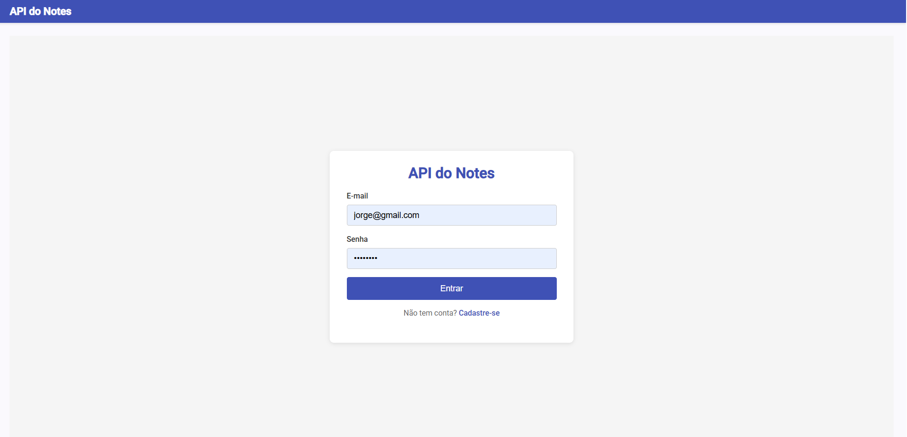
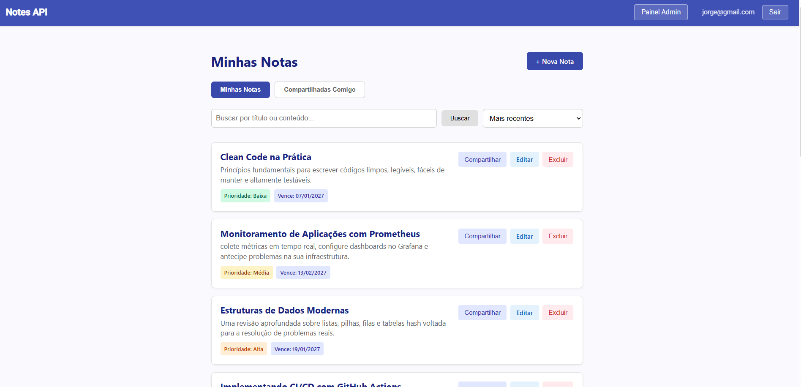

# Notes API

[](https://github.com/paulohscoelho/note-api/actions/workflows/ci.yml)


Aplicação **full-stack** para gerenciamento e compartilhamento de notas, com autenticação JWT, autorização por roles (RBAC), migrações versionadas e deploy automatizado em produção.

## 🌐 Links de Produção

| Serviço | URL |
|---|---|
| **Frontend (Vercel)** | https://note-api-delta.vercel.app |
| **Backend (Render)** | https://note-api-8qb4.onrender.com |
| **Health Check** | https://note-api-8qb4.onrender.com/actuator/health |
| **Swagger UI** | https://note-api-8qb4.onrender.com/swagger-ui.html |

> ⚠️ O backend está no plano **Free do Render**. Um monitor do **UptimeRobot** faz um ping a cada 5 minutos no endpoint `/actuator/health` para manter a aplicação ativa. O primeiro acesso pode levar até 30 segundos caso o servidor hiberne.

## 📸 Telas do Sistema

| Tela de Login | Minhas Notas (com Compartilhamento) |
| :---: | :---: |
|  |  |

*(Se tiver a foto do painel de admin, você pode adicionar aqui embaixo. Exemplo: ``)*

## 📖 Sobre

A **Notes API** é uma aplicação full-stack para gerenciamento de notas. Cada usuário pode criar, consultar, atualizar e remover suas próprias notas, atribuindo a elas níveis de **prioridade** e **data de vencimento**.

A autenticação é feita via **JWT**: o cliente faz login com email e senha, recebe um token e o envia no header `Authorization`. O acesso é controlado por **roles** (`USER` e `ADMIN`) combinadas com **ownership** dos recursos.

O isolamento de dados é garantido: um usuário `USER` enxerga apenas os próprios recursos. Já o `ADMIN` possui acesso a um **Painel Administrativo** para gerenciar usuários. Além disso, o sistema conta com uma feature de **Compartilhamento de Notas** (relacionamento Muitos-para-Muitos), permitindo que um usuário conceda acesso de leitura a outro usuário sem perder a propriedade da nota.

## ✨ Funcionalidades

- **Autenticação JWT** com login via email e senha.
- **Autorização por roles** (`USER` / `ADMIN`) com proteção no Backend e Frontend (Guards).
- **Compartilhamento de Notas:** Um usuário pode compartilhar suas notas com outros usuários via e-mail, com abas dedicadas para "Minhas Notas" e "Compartilhadas Comigo".
- **Painel de Administração:** Tabela de usuários, busca em tempo real, alteração de roles e exclusão.
- **CRUD de Notas Avançado:** Inclusão de **Prioridade** (com badges coloridas) e **Data de Vencimento**.
- **Filtros e Ordenação:** Listagem de notas por mais recentes, título, maior/menor prioridade e vencimento.
- **Paginação e Busca:** Busca textual por título/conteúdo e paginação de resultados.
- **Versionamento de Banco:** Migrações estruturadas com **Flyway** (V1 a V4).
- **Tratamento de erros padronizado** (404, 409, 400, 401, 403, 500).
- **Seed idempotente** do admin inicial via variáveis de ambiente.
- **Containerização completa** (Postgres + app + Adminer).
- **CORS configurado** para múltiplas origens (dev e produção).
- **Testes Automatizados:** Testes unitários (Mockito) e de integração (Testcontainers).
- **Cobertura de Código:** Validação de cobertura com **JaCoCo** (mínimo de 80%).
- **CI/CD:** GitHub Actions para testes/cobertura e deploy automático (Render/Vercel).

## 🛠️ Tech Stack

| Categoria | Tecnologia |
|---|---|
| Linguagem Backend | Java 21 |
| Framework Backend | Spring Boot 4.1.1 (Spring MVC / Spring Data JPA) |
| Framework Frontend | Angular 20 (standalone components, signals, guards, interceptors) |
| Banco de Dados | PostgreSQL 16 (Docker local) / PostgreSQL 18 (Neon em produção) |
| Migração de Banco | Flyway |
| Autenticação | Spring Security + JWT (JJWT 0.12.5) |
| Build Backend | Maven (via wrapper `./mvnw`) |
| Build Frontend | Angular CLI + npm |
| Container | Docker + Docker Compose |
| Testes | JUnit 5, Mockito, Testcontainers, AssertJ, JaCoCo |
| CI/CD | GitHub Actions |
| Deploy | Render (Backend), Vercel (Frontend), Neon (Banco) |

## 🚀 Como Rodar

### Opção A — Stack completa via Docker (backend + banco)

**Pré-requisitos:** Docker Desktop instalado.

1. Clone o repositório:
   ```bash
   git clone https://github.com/paulohscoelho/note-api.git
   cd note-api